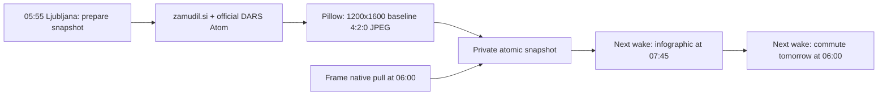

# bloomin8-pull-server

Small Python server for BLOOMIN8 scheduled pull mode.

It exposes:
- `GET /health`
- `GET /eink_pull`
- `GET /eink_signal`
- `GET /image/<token>/<name>_L.jpg`

The server reads the latest daily image from the public Famous People Infographic Network archive (or an optional local archive), prepares a BLOOMIN8-compatible landscape JPEG, and returns a public image URL to the frame.

## Why this exists

BLOOMIN8 supports a native pull workflow via `/upstream/pull_settings`:
- the frame sleeps until a configured UTC `cron_time`
- then wakes up and calls `{upstream_url}/eink_pull`
- downloads the returned `image_url`
- displays it
- sleeps again until `next_cron_time`

This avoids the push-while-sleeping problem common with battery-powered e-ink frames.

## Features

- token-protected `/eink_pull` via `X-Access-Token`
- tokenized image URL path segment
- automatic latest-image lookup from a remote or local `latest.json`
- dynamic JPEG preparation using `ffmpeg`
- landscape `_L.jpg` output for BLOOMIN8 pull mode
- optional `/eink_signal` feedback endpoint
- simple systemd user-service deployment
- works well behind Tailscale Funnel

## Repository layout

- `bloomin8_pull_server.py` — main HTTP server
- `configure_bloomin8_pull.py` — helper to configure the device via `/upstream/pull_settings`
- `bloomin8_pull_config.example.json` — example config (no secrets)
- `systemd/bloomin8-pull.service` — user systemd unit
- `.gitignore`

## Requirements

Runtime dependencies:
- Python 3.11+
- `ffmpeg`

The infographic-only HTTP server uses the Python standard library. The optional
commuter snapshot needs Pillow, requests and system DejaVu fonts (on Debian:
`python3-pil python3-requests fonts-dejavu-core`). No browser or LLM is used.

## Optional morning commuter edition

Set `commute_snapshot_path` to a private absolute `snapshot.json` path and
`commute_local_time` to `06:00`; set `scheduled_local_time` to `07:45`.
Both times are interpreted in the configured `Europe/Ljubljana` timezone,
including DST. Without a snapshot path the previous single-image mode remains.



Prepare a live snapshot:

```bash
python3 commute_board.py --config /private/path/frame-config.json
```

Successful runs are silent. Unavailable/stale sources produce an explicit warning
on the image and stdout; they never produce a fabricated all-clear. Keep the
snapshot directory private and outside public static directories. The existing
token-protected image endpoint serves only today's non-demo manifest image.
Mock previews are separate and cannot be published into the daily feed:

```bash
python3 commute_board.py --mock-preview /private/path/demo_P.jpg
```

The native wake must be armed once on the awake device through
`PUT /upstream/pull_settings`, followed by GET read-back. Changing this server's
config cannot wake a sleeping device or rewrite a wake already stored on it.
The first already-stored older wake will adopt the two-slot cycle, but can miss
the first 06:00 edition. Use `configure_bloomin8_pull.py --arm-next` to set the
next configured local slot when the device is awake (tokens are not printed).

### Data provenance and limitations

- SŽ's requested help/delays page returned Cloudflare 403 during implementation.
  It is **not** scraped or represented as solved. Rail data comes from the
  independent public `zamudil.si` frontend backend, not an official SŽ API:
  `https://api.zamudil.si/api/global`, `/stations/Kranj/board`, and each candidate
  train's `/trains/<label>/timeline?day=<date>`. This is an observed public-web
  interface, not a guaranteed supported API; no authenticated access is used.
- Verify service date and global source freshness (10 minutes); use the ordered
  stop timeline to prove Kranj precedes a Ljubljana stop and take **Kranj
  departure** delay, not a train-wide maximum. Display delayed/cancelled trains
  in the next two hours; count missing live predictions separately. A successful
  query without a delay report does not guarantee punctuality. The board is a
  dated morning snapshot, not a continuously updating departure board.
- Official road source:
  `https://www.promet.si/dc/b2b.dogodki.rss?roadtype=highway&eventtype=all&language=sl_SI`.
  It is Atom XML despite the RSS suffix; decode bytes as XML, verify feed.updated
  freshness, and filter the A2-E61 Kranj–Ljubljana corridor and actual direction.
  Exclude A2-E70, northern events and Jesenice-bound incidents; retain relevant
  both-direction/unspecified-direction warnings. The public feed has prose, not
  coordinates/structured travel time. Do not derive travel minutes from queue
  length or call an empty filtered feed a measured free-flowing road.
- At most three train alerts and two road warnings fit; overflow is explicitly
  counted. Sources, snapshot time and missing-data warnings remain visible.
- Station-information principles: clear hierarchy, high contrast, large sans
  body/numerals and no color-only meanings. The newspaper serif is restricted to
  the masthead; this is not a claim of certified railway-signage compliance.
- The frame accepts JPEG or raw dithered image data, not documented HTML input.
  Direct Pillow drawing avoids a Chromium process and HTML-to-image dependency.

On a Europe/London Hermes host, daily `55 4 * * *` is 05:55 Ljubljana under the
current shared European DST transition rules. Frame display remains 06:00 local
through its native pull; source preparation has a five-minute buffer. If the
host timezone or DST rules change, revisit the cron conversion.

## Config

Copy the example config and fill in your values:

```bash
cp bloomin8_pull_config.example.json bloomin8_pull_config.json
```

Important fields:
- `display_orientation`: `portrait` for an upright portrait-mounted frame, or
  `landscape` (backward-compatible default). Portrait fits directly to the
  portrait screen dimensions without rotation and uses `_P.jpg`; landscape
  retains pre-rotation and `_L.jpg`. Both preserve the whole source without
  cropping, padding only where aspect ratios differ.
- `timezone`
- `scheduled_local_time`
- `retry_interval_minutes`
- `public_base_url`
- `device_token`
- `image_token`
- `device_width`
- `device_height`
- `latest_json_url` and `image_base_url` for the public archive
- `latest_json_path` as an alternative local source

For the live Infographic Network, use:

```text
latest_json_url=https://lukafin.github.io/artists-infographic-archive/latest.json
image_base_url=https://lukafin.github.io/artists-infographic-archive/
```

Remote metadata requests bypass intermediary caches so a newly published morning infographic is seen promptly.

## Run locally

```bash
python3 bloomin8_pull_server.py --host 127.0.0.1 --port 8092 --config ./bloomin8_pull_config.json
```

Health check:

```bash
curl http://127.0.0.1:8092/health
```

Manual pull test:

```bash
curl -H 'X-Access-Token: <device-token>' \
  'http://127.0.0.1:8092/eink_pull?device_id=test&pull_id=abc&cron_time=2026-04-13T09:00:00Z&battery=50'
```

## Deploy with systemd

Copy the service file and update the paths if needed:

```bash
mkdir -p ~/.config/systemd/user
cp systemd/bloomin8-pull.service ~/.config/systemd/user/
systemctl --user daemon-reload
systemctl --user enable --now bloomin8-pull.service
systemctl --user status bloomin8-pull.service
```

## Expose publicly with Tailscale Funnel

Example path-based route:

```bash
sudo tailscale funnel --bg --set-path /bloomin8-pull 8092
sudo tailscale funnel status
```

Example public base URL:

```text
https://your-host.ts.net/bloomin8-pull
```

## Configure the frame

Use the helper script:

```bash
python3 configure_bloomin8_pull.py --arm-next --ip <frame-ip> --expected-sn <verified-device-serial>
```

It sends:
- `upstream_on=true`
- `upstream_url=<public_base_url>`
- `token=<device_token>`
- `cron_time=<next configured local slot>` with `--arm-next`; omitting this flag
  schedules a test in three minutes. The exact serial must be supplied through
  `--expected-sn` or the private config's `expected_device_sn` before any write.
  Successful output is token-free and requires GET schedule read-back.

Or call the device directly:

```bash
curl -X PUT http://<device-ip>/upstream/pull_settings \
  -H 'content-type: application/json' \
  -d '{
    "upstream_on": true,
    "upstream_url": "https://your-host.ts.net/bloomin8-pull",
    "token": "your-secret-token",
    "cron_time": "2026-04-13T09:44:17Z"
  }'
```

## BLOOMIN8 pull image notes

For native pull mode, the vendor docs require:
- JPEG images
- filenames ending in `_P.jpg` or `_L.jpg`
- for landscape mode, serve `_L.jpg`
- the file itself should be stored rotated for the device’s landscape handling

This server prepares that dynamically from the source archive image. Output is
baseline JPEG with explicit `yuvj420p` (4:2:0) sampling. Filenames contain
`-jpeg420-v1` so a frame that cached a failed older encoding performs a new decode.
This is a compatibility workaround to validate on the physical frame, not a
vendor-documented 4:2:0 requirement.

Once today's image is available, the response schedules the next local calendar
day's configured wake time—even if a fast device clock wakes the frame before
today's server-side scheduled instant. Stale-image responses retain the retry
interval. Local daily wake time is preserved across daylight-saving changes.

Run regressions (including an actual FFmpeg JPEG sampling check):

```bash
python3 -m unittest discover -s tests -v
```

For device-side verification use GET `/log/list` and
`/log/YYYY-MM-DD.log`. A successful download or `success=1` feedback alone does
not prove a screen refresh: firmware can mark a failed current image as already
displaying on a subsequent pull. Confirm no `Image parsing failed`, no shortcut
`Currently displaying, mark directly`, and ask the viewer to confirm the panel.

## Security notes

- `device_token` is required for `/eink_pull`
- image URLs are protected by an unguessable path token
- do not commit real secrets
- use HTTPS for public exposure

## License

MIT
